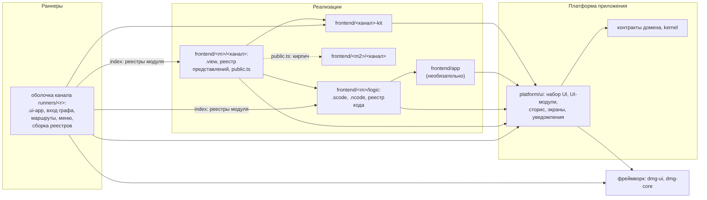

# Слои фронта

**Назначение:** почему фронт на `dmg-ui` разложен на описание, реализации модулей и оболочку канала, куда направлены зависимости, как UI-модули общаются, не импортируя друг друга, и ради каких сценариев роста всё это устроено. Читать перед первым UI-модулем и когда непонятно, куда положить экран, код или представление и почему импорт запрещён. Оси, единица выноса и сценарии бэка — `node_modules/dmg-core/docs/concepts/layers.md`: фронт стоит на тех же осях.

---

## Схема

Зависимости направлены в одну сторону: оболочка → реализации модулей → общее фронта → описание → домен → фреймворк. Реализации бэка и слои фронта друг друга не видят ни в одну сторону. Кто что видит — таблица слоёв [D-UI-117](../decisions.md), правила — UI-28…UI-34 в [rules.md](../reference/rules.md#слои-фронта).

## Как это работает

1. **Описание** — `platform/ui`, ось платформы приложения: набор UI (`UiSetDef`), UI-модули, сторис, экраны, уведомления. Оно нейтрально к каналу и видит только `kernel`, контракты домена и `dmg-ui` (UI-28). Граф строится из описания и файлов оболочки, которые реестров не берут (`.ui-app`, маршруты, размещения): вход графа, дошедший до кода экранов или представлений, — ARC-16 `dmg-core`.
2. **Реализации модуля** — `frontend/<m>/logic`: код экранов (`.scode`) и уведомлений (`.ncode`), нейтрально к каналу (UI-30); `frontend/<m>/<канал>`: представления модуля в канале (UI-31). Код исполняет — вызывает UC, ведёт действия, — поэтому он в реализации, как UC в `backend/<m>`, а не в описании. Оба дерева повторяют дерево описания: папка UI-модуля, в ней папка на каждую сторис и `shared/` для общего; манифест, код и представление — пара по имени и пути (`NM-01`). Канал может стоять на канале-базе: представления `telegram` перекрывают общие представления мессенджеров `chat`. Общее без хозяина — `frontend/app` (над доменом, UI-29) и `frontend/<канал>-kit` (кирпичи и тема канала, UI-33).
3. **Реестры — на модуль.** `CodeLoaders.of`, `ChatViews.of` (с перекрытием `over`) и `PageViews.of` принимают `UiModuleDef` и полны по модулю: экрану и уведомлению — ровно один загрузчик и одно представление, иначе отказ конструктора UI-06. Вход `index.ts` кода и канала модуля отдаёт реестр — оболочке и только ей (UI-34).
4. **Оболочка канала** — раннер `runners/<r>`: приложение UI, вход графа и `.arch`, точки входа, маршруты, меню, тема, транспорт. Она собирает реестры модулей своего приложения (`AppCodeLoaders`, `AppChatViews`, `AppPageViews` на `ModuleRegistries`) и передаёт сборку исполнителю и рендерерам. Лимиты мессенджера (CH-01) меряет тест на этой сборке (`ExampleLimits`), а не граф.
5. **Между модулями** — только переход на `start` чужой сторис (`leads`). Это аналог фасада бэка: манифест сторис — контракт, адрес — команда, `ScreenRuntime` с реестром — `dispatch`, исход `after: 'back'` — ответ. Чужой экран в свою сторис не включается (UI-35), исход и ссылка уведомления в чужой модуль ведут только на `start` (UI-36), чужой код не импортируется. Кирпич с хозяином канал модуля отдаёт соседям через `public.ts` (UI-32), кирпич без хозяина лежит в `<канал>-kit`; отступление «когда очень нужно» — запись реестра долга с правилом UI-32 и местом (ARC-12 `dmg-core`). Граница модуля — граница фреймворка и ленивой загрузки.
6. **Раздел и вспомогательный модуль** — по связям, поля в манифесте нет. Корневая сторис набора — та, в которую не ведёт ни одна `leads` (меню); её переходы не в счёт. Раздел — модуль, у которого есть сторис, в которую ведут только корневые сторис или никто: кнопка меню и всё, что от неё растёт. Вспомогательный — модуль без такой сторис, хозяин сторис, в которые ведут другие разделы («запись на поток», онбординг); имя — по цели, а не `shared`. В него ведут не меньше двух модулей (UI-37), иначе его сторис — у единственного пользователя. Признак — свойство `section` узла `uiModule` в выводе графа; его читают инструменты разработки над выводом графа — MCP об устройстве приложения и документация по графу; пакет признак только считает. Аудиторию раздел обычно задаёт сам, доступ — `callers` и `access` сторис.
7. **Экран, сторис или модуль.** Сторис внутри сторис нет: `leads` — граф, а не дерево, поэтому папки сторис — один уровень.

| Что | Когда | Где лежит |
|---|---|---|
| экран своей сторис | ни одного признака сторис: шаг общей цели, без своего исхода и доступа, один вход | папка сторис |
| общий экран модуля | только показ, нужен ≥2 сторис модуля | `<m>/shared/` |
| отдельная сторис модуля | хоть один признак: своя цель, свой исход или доступ, больше одного входа, многошаговость | своя папка в модуле |
| сторис другого модуля | цель принадлежит другому разделу; нужна двум — лежит у владельца цели, второй ведёт `leads` | модуль владельца |
| вспомогательный модуль | у цели нет раздела-хозяина, а ведут в неё ≥2 модулей | свой модуль, имя по цели |

Папка сторис на 8–10 экранов — повод проверить группы её экранов по признакам сторис, а не вкладывать глубже.

Образец — учебный проект [packages/example](../../packages/example/src/) формы `single` (D-UI-121): разделы `todo` и `profile`, вспомогательный модуль `users` (в него ведут оба раздела), общий экран и уведомления в `todo/shared/`, кирпич `AccountStatus` через [users/chat/public.ts](../../packages/example/src/frontend/users/chat/public.ts), DOM-помощники в `web-kit`, перекрытие Telegram в `todo/telegram/`; оболочки — `runners/dialog`, `runners/tg-bot`, `runners/web`. Раскладка, виды и точки регистрации — [naming.md](../reference/naming.md).

## Сценарии роста

**Сценарии предусмотрены решениями и раскладкой, но вживую не проверены.** Машина проверяет только структуру: слои фронта, границы пакетов и объявленные зависимости (`arch:check`), границу модулей описания (UI-35…UI-37), полноту реестров модуля (UI-06), лимиты мессенджера (CH-01), имена и место файлов (`NM-01`). Вынос фронт-модуля в свой репозиторий, раздел на другом фреймворке, веб-компонент кирпича и ленивую загрузку реестра раздела пакет не исполняет; проверка и правка — при первом реальном выносе.

Сценарий — устойчивый ID случая, ради которого существует усложнение: решение, которое добавляет пакет, слой, вход или запрет, ссылается на сценарий из этой таблицы ([D-UI-116](../decisions.md)). Статус: «предусмотрен» — обеспечен решениями и раскладкой; «проверен вживую: <проект>, <дата>».

| ID | Сценарий | Что требует | Статус |
|---|---|---|---|
| GR-UI-01 | Фронт-модуль одного канала уходит в свой репозиторий и команду | пара «модуль × канал» — свой каталог и пакет со входами `index` (реестры для оболочки) и `public` (кирпичи для чужих модулей); канал модуля не видит внутренностей чужих модулей и другого канала; реестры модуля полны сами по себе; единица проверяет себя тестом (UI-06, CH-01, `NM-01`) без оболочки и чужого графа; граф строится без реализаций фронта | предусмотрен |
| GR-UI-02 | Канал целиком уходит в свой репозиторий и команду | оболочка канала — в раннере; представления модулей канала — свои пакеты; описание и код экранов нейтральны к каналу и при выносе публикуются пакетами | предусмотрен |
| GR-UI-03 | Разделы web пишутся на разных фреймворках | раздел — UI-модуль; граница раздела — граница монтирования: между модулями только переход на `start` чужой сторис, чужие экраны в сторис не включаются; представления раздела — свой пакет со своим фреймворком | предусмотрен |
| GR-UI-04 | Общий кирпич нужен разделам на разных фреймворках | кирпич с хозяином — в публичном входе канала модуля, без хозяина — в `<канал>-kit`; описание кирпича (карточка) — в описании; в web — веб-компонент | предусмотрен |
| GR-UI-05 | Новый канал подключается без правки описания | описание и код экранов не видят каналов; граф строится из описания и оболочки; правило канала одно на все каналы, канал — параметр поставщика; канал может стоять на канале-базе | предусмотрен |
| GR-UI-06 | Раздел вырос до десятков сторис: файл находится по цели человека | папка сторис в описании, то же дерево в коде и в канале модуля; один уровень; `NM-01` | предусмотрен |
| GR-UI-07 | Раздел грузится по нажатию кнопки меню | у модуля свой реестр кода и представлений; граница модуля — граница загрузки; загрузчик реестра раздела не реализован | предусмотрен |

## Почему так

Правило → сценарий → решение:

- Описание — на оси платформы приложения, код и представления модуля — на оси реализаций, оболочка — в раннере: вынесенная пара «модуль × канал» не тянет чужих модулей и оболочки, канал уезжает со своей оболочкой → GR-UI-01, GR-UI-02 → D-UI-117.
- Описание и код экранов не видят каналов, правило канала одно на все каналы, канал может стоять на базе: новый мессенджер встаёт поверх `chat` без копий и без правки описания → GR-UI-05 → D-UI-117.
- Код экрана — в реализации, а не в описании: он исполняет, а граф строится из описания → GR-UI-05, GR-02 `dmg-core` → D-UI-117.
- Представления — в модуле, а не в слое канала поперёк модулей: единица выноса и микрофронтенда — раздел → GR-UI-01, GR-UI-03 → D-UI-117.
- Реестры — на модуль, сборка — у оболочки, полнота — конструктором (UI-06): вынесенный модуль проверяет себя без оболочки, загрузчик раздела встаёт на его реестр → GR-UI-01, GR-UI-07 → D-UI-118.
- Граф без реализаций фронта, ребра `presents` нет, CH-01 — тестом на сборке: вход графа не тянет представления всех каналов → GR-UI-01, GR-UI-05 → D-UI-118.
- Папки сторис, одно дерево в описании, коде и канале (`NM-01`): файл находится по цели человека → GR-UI-06 → D-UI-119.
- Между модулями — только `start` чужой сторис (UI-35, UI-36): граница модуля — граница фреймворка и загрузки → GR-UI-03, GR-UI-07 → D-UI-119.
- Вспомогательный модуль — по связям и с ≥2 пользователями (UI-37): модуль одного пользователя уехал бы вместе с ним, модуль без цели стал бы свалкой `shared` → GR-UI-01 → D-UI-119.
- Кирпич — через `public.ts` или `kit`, отступление — записью долга, а не списком исключений → GR-UI-01, GR-UI-04 → D-UI-120.
- Учебный проект в той форме, которую пакет требует от потребителя, и `arch:check` на нём в `check` репо → GR-UI-01…GR-UI-07 → D-UI-121.

## Где дальше

- Куда положить файл и где его зарегистрировать — [naming.md](../reference/naming.md); правила с ID — [rules.md](../reference/rules.md).
- Написать сторис, экран и уведомление — [story-screen-notification.md](../guides/story-screen-notification.md); пакет канала — [channel-package.md](../guides/channel-package.md).
- Решения раскладки — [D-UI-116…D-UI-121](../decisions.md#раскладка-фронта-и-единица-выноса).
